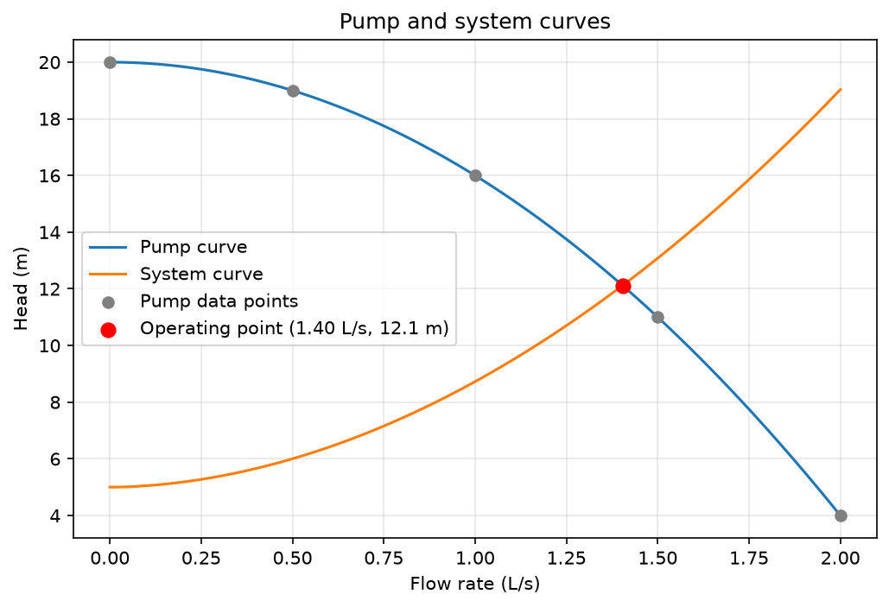
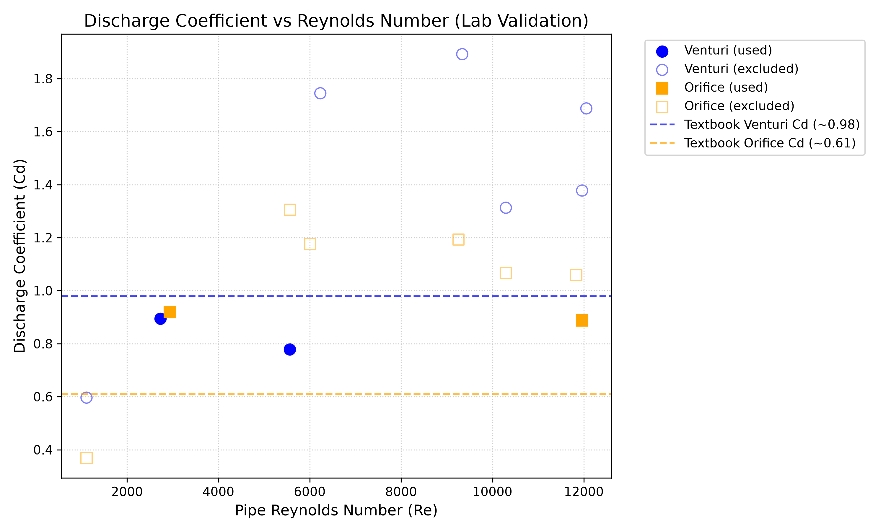

# Pump-Piping System Simulator

Python/Streamlit tool that calculates pipe pressure drop, the operating point of a centrifugal pump in a piping system, and flow through Venturi and orifice meters. Validated against my own fluid mechanics lab data.

**Live app:** https://pump-piping-model-vv6glbjfmvv9hxtjnnt9u9.streamlit.app/

## Features
- **Pump and system:** friction loss in straight pipe and fittings, pump curve fit, operating point (flow and head where pump curve meets system curve)
- **Meter calculator:** flow rate from a manometer reading for a Venturi or orifice meter
- **Lab validation:** discharge coefficient (Cd) vs Reynolds number from my own experiment, compared with textbook values
- Input checks everywhere (bad inputs raise clear errors), and a pytest suite for every module

## Example result
Water in 10 m of 25.4 mm pipe with 4 elbows, 1 globe valve, entrance and exit, 5 m static head:



Operating point: about **1.40 L/s at 12.1 m**.

## Methods
| Part | Equation / method |
|---|---|
| Reynolds number | Re = ρvD / μ |
| Laminar friction factor (Re < 2300) | f = 64 / Re |
| Turbulent friction factor (Re > 4000) | Swamee-Jain: f = 0.25 / [log10(ε/(3.7D) + 5.74/Re^0.9)]² |
| Transitional (2300 to 4000) | Straight-line interpolation between the two (approximation, a warning is issued) |
| Straight pipe | Darcy-Weisbach: h = f (L/D) v² / 2g |
| Fittings | h = K v² / 2g, K values summed for fittings in series |
| Pump curve | Quadratic fit H = a + bQ + cQ² |
| System curve | H = H_static + ΔP_total(Q) / ρg |
| Operating point | Root of pump head minus system head (scipy brentq) |
| Meters | Q = Cd · A · √(2ΔP / (ρ(1 − β⁴))), ΔP = (ρ_manometer − ρ) g h |

## Lab validation
Experiment: flow measurement with Venturi, orifice and rotameter (pipe 25.4 mm, Venturi throat 14.67 mm, orifice 14.6 mm, CCl4 manometer, water). Actual flow from collected volume and time. 16 readings from my own sheet and a second group's sheet.



| Meter | Readings used | Mean Cd | Textbook Cd | Error |
|---|---|---|---|---|
| Venturi | 2 | 0.837 | about 0.98 | -14.6% |
| Orifice | 2 | 0.903 | about 0.61 | +48.1% |

**Exclusion rule (applied in code):** a reading is excluded if its collected volume conflicts with the rotameter setting (2 readings) or if Cd ≥ 1, which is physically impossible (10 readings). 12 of 16 readings were excluded; all are shown in the app.

**Honest assessment:** the validation is weak. Most readings gave Cd above 1, meaning the measured pressure difference was too small for the flow. Likely causes: air bubbles in the manometer lines, short collection times (5 s) and manometer fluctuation. Excluding only readings that are too high biases the means downward, so they are not unbiased estimates. The orifice result is far from 0.61 and should not be read as validated. Textbook Cd values are for high Reynolds numbers, while the lab ran at Re of about 1,000 to 12,000. A repeat run with longer collection times and bled manometer lines is needed.

## Assumptions and limitations
- Incompressible, single-phase, steady flow; single pipe diameter
- K values are typical textbook values and vary by source [cite your textbook]
- The transitional-range friction factor is an interpolation, not a measured value
- The pump curve is a quadratic fit and is only valid within the range of the data
- Static head is entered by the user; no pipe elevation profile

## Run locally
```
pip install -r requirements.txt
streamlit run app.py
python -m pytest
```

## Structure
```
src/          friction.py, pipe.py, pump.py, meters.py, validation.py
tests/        pytest tests for each module
scripts/      plot_operating_point.py, plot_validation.py
data/         lab_data.csv
docs/         figures
app.py        Streamlit app
```
